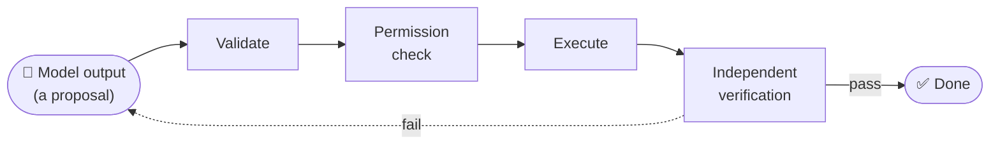

 

  

 

<h2 align="center">👋 Hey, I'm Jayanth</h2>

<h3 align="center"><code>Agents</code> × <code>Systems</code> × <code>Markets</code></h3>

I build software where <b>AI is allowed to act</b>, and where code, not the model, decides what is safe. 
Right now that means a native macOS intelligence system, a coordination layer for desktop AI agents, 
and a steady stream of quantitative research on WorldQuant BRAIN.

 

<table align="center">
  <tr>
    <td width="33%" valign="top">
      <h3>⚙️ 01 · BUILD</h3>
      <b>Agents with guardrails</b> 
      Local-first systems that act on a real machine, with deterministic permission checks around every model.  
      <code>DESIGN</code> → <code>SHIP</code> → <code>VERIFY</code>
    </td>
    <td width="33%" valign="top">
      <h3>📈 02 · RESEARCH</h3>
      <b>Signals from noise</b> 
      Designing and testing quantitative alphas, and keeping only what survives the checks.  
      <code>HYPOTHESIS</code> → <code>TEST</code> → <code>ITERATE</code>
    </td>
    <td width="33%" valign="top">
      <h3>🌍 03 · LEARN</h3>
      <b>In the open</b> 
      Compounding small wins across systems, finance and product, shared as I go.  
      <code>EXPLORE</code> → <code>SHARE</code> → <code>IMPROVE</code>
    </td>
  </tr>
</table>

 

<h2 align="center">🧰 The Toolbox</h2>

<i>Different tools for different problems. These are the ones I reach for.</i>

  

 

<h2 align="center">🚀 The Build Lab</h2>

<i>Not just repositories. Systems with a point of view.</i>

<table align="center">
  <tr>
    <td width="50%" valign="top">
      <h3><a href="https://github.com/jayanth-afk/ZiA">🧠 ZiA</a></h3>
      <b>NATIVE macOS PERSONAL INTELLIGENCE SYSTEM</b>
      
An assistant where models only <i>propose</i>. Intent, permissions, execution and verification are owned by code. It keeps identity, memory and task state across provider changes, runs tasks in parallel through dependency graphs, and routes between local MLX and cloud models by capability, privacy, cost, latency and quota.

      
      
      
        
      
    </td>
    <td width="50%" valign="top">
      <h3><a href="https://github.com/jayanth-afk/AgentBridge">🌉 AgentBridge</a></h3>
      <b>LOCAL-FIRST COORDINATION FOR DESKTOP AI AGENTS</b>
      
A bridge that lets desktop AI agents discover each other, exchange tasks and work on local repositories. It adds correlated task and response exchange, multi-hop pipelines, a live operator dashboard, and a default-deny security model with path containment, replay guards and human approval for skills.

      
      
      
        
      
    </td>
  </tr>
  <tr>
    <td width="50%" valign="top">
      <h3><a href="https://github.com/jayanth-afk/TickTalker">🥇 TickTalker</a></h3>
      <b>GOLD PRICE & MARKET NEWS DASHBOARD</b>
      
A web dashboard that tracks the gold price next to market headlines, with price-change tracking, a refreshing chart and a news feed. Plain HTML, CSS and JavaScript on top of market-data APIs.

      
      
      
        
      
    </td>
    <td width="50%" valign="top">
      <h3>🧪 Alpha Lab</h3>
      <b>10 ALPHAS IN 10 DAYS · WORLDQUANT BRAIN</b>
      
A disciplined research sprint on the USA / D1 / TOP3000 universe: batches of candidate signals, strict acceptance gates on Sharpe, fitness and turnover, and a focus on low correlation between submissions.

      
      
    </td>
  </tr>
  <tr>
    <td colspan="2" valign="top">
      <h3><a href="https://github.com/jayanth-afk/EduWrap">📚 EduWrap</a> · capstone team project</h3>
      <b>COLLABORATIVE STUDY PLATFORM FOR COLLEGE STUDENTS</b>
      
Notes, chat, flashcards, quizzes and study rooms in one interface, with XP and streak tracking. A frontend prototype built with React, Vite, Tailwind CSS and Framer Motion, with all dynamic behavior simulated through React state and localStorage.

      
      
      
      
        
      
      
    </td>
  </tr>
</table>

 

<h3 align="center">🛡️ The idea behind ZiA: models propose, code decides</h3>

 

<h2 align="center">🗂️ The Repository Wall</h2>

<i>Live cards. Descriptions and languages update straight from GitHub.</i>

 

 

<h2 align="center">📊 The Activity Lab</h2>

<i>GitHub stats, streaks and contributions, live.</i>

  

  

 

<h3 align="center">🏆 Trophy shelf</h3>

 

<h3 align="center">🐍 Watch the contributions come alive</h3>

<picture>
  <source media="(prefers-color-scheme: dark)" srcset="https://raw.githubusercontent.com/jayanth-afk/jayanth-afk/output/github-contribution-grid-snake-dark.svg" />
  <source media="(prefers-color-scheme: light)" srcset="https://raw.githubusercontent.com/jayanth-afk/jayanth-afk/output/github-contribution-grid-snake.svg" />
  
</picture>

 

<h2 align="center">🤝 Let's build something together</h2>

  

<h3><i>"Models propose. Code decides."</i></h3>

Thanks for stopping by. Browse the projects, follow the trail, and say hi.

